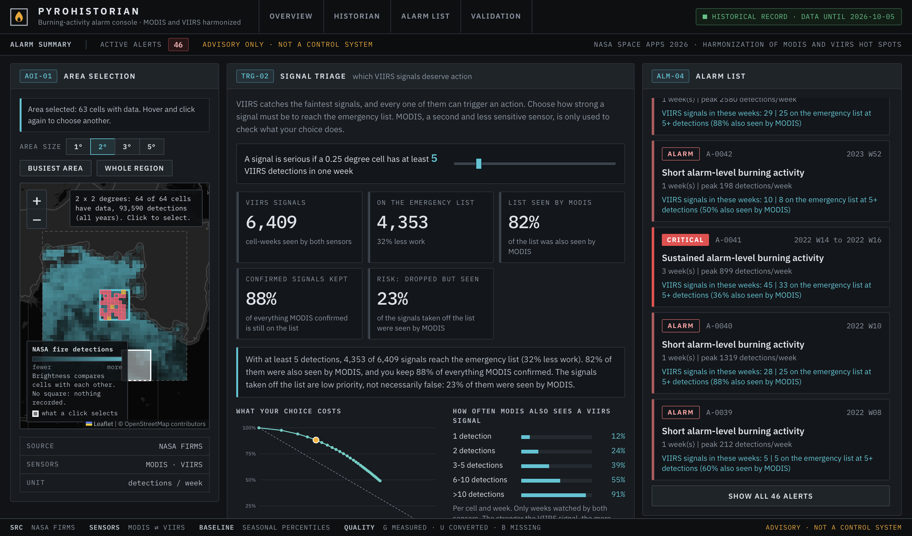

# PyroHistorian

NASA Space Apps Challenge 2026 - challenge: **Harmonization of MODIS and VIIRS Hot Spots**.

> AI disclosure: much of the code and documentation was written with the help of AI assistants (Claude, by Anthropic) and
> reviewed by the team. Every source file starts with a disclosure line. The text of the alarm cards is built by fixed rules
> from numbers; no AI model runs inside the web page.

## In one paragraph

Two satellite sensors report active fires, but VIIRS (375 m) is far more sensitive than MODIS (1 km). That breaks the long
record (a false jump in 2012) and makes VIIRS raise many alarms that need no action. PyroHistorian (1) harmonizes the two records
into one burning-activity calendar with an honest uncertainty range, and (2) lets a user tell serious VIIRS signals from faint
ones, using the other sensor as an independent check. It runs in the browser on three small JSON files, and everything comes from
NASA FIRMS data.

## UI Preview

## What it does

1. **Harmonized calendar.** MODIS counts are converted to the VIIRS scale with a monthly ratio learned from the overlap years
   (2012 onward), with a low to high range. Every cell-week has a quality code: `G` measured, `U` converted, `B` missing.
2. **Alarms.** For any area chosen on the map, a seasonal baseline (percentiles of the same week in the other years), a minimum
   count and hysteresis give Normal / Elevated / Alarm states and critical periods. These are methods borrowed from industrial
   alarm management, not a control system.
3. **Signal triage (the interactive part).** The user chooses how strong a VIIRS signal must be to reach the emergency list. The
   page shows at once what the choice does: how much work is removed, how much of the remaining list the second sensor also saw,
   what share of confirmed signals is kept, and what the price is. A week inspector paints the cells on the map: seen by both
   sensors, VIIRS only, low priority, or MODIS only.

## Main findings (current region and data)

Region: 10 x 10 degrees in northern Australia (10 to 20 degrees south, 130 to 140 degrees east), 2000 to 2026.

- VIIRS counts about **7 to 8.6 times** more detections than MODIS in the same weeks (monthly median ratios).
- Conversion check (leave one year out, 172 cases): the real VIIRS total was inside the low to high range in 86% of cases.
  This is about what a min to max range gives, so it shows the range is honest, not that the model is exact.
- **Faint VIIRS signals are rarely seen by MODIS.** A cell-week with 1 VIIRS detection is also seen by MODIS 14% of the time, with
  more than 10 detections 89% of the time.
- A threshold of 5 detections takes **29%** of the 102,628 signals off the emergency list, raises the share of the list that MODIS
  also saw from 65% to 81%, and keeps 90% of everything MODIS confirmed. The price: 24% of the removed signals were seen by MODIS.
- **Negative result:** a richer score (neighbours, continuity) did not separate confirmed signals better than strength alone
  (AUC 0.869 against 0.875), so the interface uses the simple rule.

Details, tables and limits: [`docs/METHODS_AND_LIMITS.md`](docs/METHODS_AND_LIMITS.md).

## Limits (short version)

- There is **no ground truth**. "Seen by MODIS" is indirect evidence, not accuracy, and "not confirmed" does not mean "false".
  The tool lowers priority and never deletes a signal.
- The conversion cannot be validated before 2012 (no VIIRS then).
- One region only. Alarms are historical and retrospective (the baseline uses all other years), not a live warning.
- PyroHistorian never sends commands and does not control anything.

## Run it

Requirements: Python 3 (with `numpy` and `pandas`), a browser (internet is needed only for the map background tiles), and Node.js (only for
the evaluation script).

**Only the web page** (the generated data are in the repository):

    python3 -m http.server 8000

Then open http://localhost:8000/web/index.html and move the pointer over the map (the squares that a click would select light up and a readout says how much data is there), choose the area size (1, 2, 3 or 5 degrees) and click.
Run the command from the project root, not from the `web` folder.

**The whole pipeline** (needs the raw FIRMS files, see [`docs/DATA_SOURCES.md`](docs/DATA_SOURCES.md)):

    pip3 install -r requirements.txt
    python3 pipeline/run_all.py              # reads data/raw, writes web/public/data/*.json, ends with the contract check
    python3 pipeline/run_all.py --use-cache  # reuses the filtered detections of the last run (much faster)

**Reproduce the triage numbers:**

    node tests/evaluate_triage.mjs

**Change the region, years or alarm settings:** edit `shared/project_config.json` and run the pipeline again.
Any change to that file is a contract change: raise `contract_version` and start the commit message with `CONTRACT:`.

## How it is built

    raw FIRMS files (data/raw)
          |
    pipeline/ (Python)  ingest, filters, weekly grid, conversion, quality codes, validation, export, contract check
          |
    web/public/data/  meta.json, cells_weekly.json, validation.json     <- the only link between the two sides
          |
    web/ (browser only)  map, weekly series, alarms, signal triage, calendar, report

    shared/project_config.json   all settings and the data contract (nothing is hardcoded in the code)
    pipeline/                    data pipeline
    web/src/                     web app (ES modules, no build step)
    docs/                        methods, data sources, data contract, interfaces, ICS mapping
    tests/evaluate_triage.mjs    reproduces the triage evaluation numbers

More: [`docs/DATA_CONTRACT.md`](docs/DATA_CONTRACT.md), [`docs/INTERFACES.md`](docs/INTERFACES.md),
[`docs/ICS_MAPPING.md`](docs/ICS_MAPPING.md), [`docs/METHODS_AND_LIMITS.md`](docs/METHODS_AND_LIMITS.md),
[`docs/DATA_SOURCES.md`](docs/DATA_SOURCES.md).

## Data and acknowledgement

All data come from NASA FIRMS (MODIS Collection 6.1; VIIRS S-NPP Collection 2). The raw files are not in the repository because of
their size: see [`docs/DATA_SOURCES.md`](docs/DATA_SOURCES.md) for the products, dates and how to download them.

We acknowledge the use of data and/or imagery from NASA's Fire Information for Resource Management System (FIRMS)
(https://earthdata.nasa.gov/firms), part of NASA's Earth Science Data and Information System (ESDIS).

The map uses Leaflet (BSD-2-Clause license, a copy is in `web/vendor/leaflet`) and OpenStreetMap tiles (c) OpenStreetMap contributors.

## Team
- **Aram Al-Jahdali**: Data pipeline, conversion models, validation, backend processing scripts, alarm logic, and signal triage.
- **Shyhanah Shaman**: Web application architecture, interactive maps, UI components, frontend views, and triage console implementation.

## License

This project is licensed under the **Apache License 2.0** - see the [LICENSE](LICENSE) file for details.

## Links

- **Demo:** [https://ar0umian.github.io/pyrohistorian/](https://ar0umian.github.io/pyrohistorian/)
- **Presentation:** [Download Slides (.pptx)](https://raw.githubusercontent.com/Ar0umian/pyrohistorian/main/submission/PyroHistorian%20Presentation.pptx)

